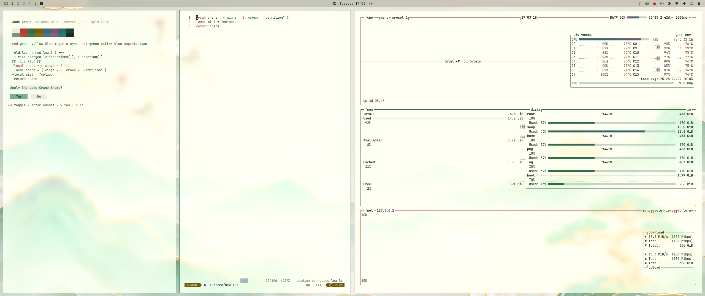

# Omarchy Jade Crane Theme

Celadon mist, carved jade, and gold leaf — a light [Omarchy](https://omarchy.org)
theme drawn from a Guofeng landscape of jade mountains, red-crowned cranes, and
lucky clouds.



## Install

```bash
omarchy theme install https://github.com/rafalyovson/omarchy-jade-crane-theme
```

Or via **Install → Style → Theme** and paste that URL.

## Palette

| Role | Hex | Note |
| --- | --- | --- |
| Background | `#f0efe6` | parchment mist |
| Foreground | `#1e3a2f` | forest ink, 10.7:1 |
| Accent | `#2f7a56` | deep jade, 4.5:1 |
| Active item | `#74b08e` / `#142820` | gum Yes/No, menus, terminal selection |
| Soft selection | `#c5d6c9` | btop rows, sidebars |
| Muted | `#7a8e83` | placeholders, line numbers, secondary buttons |
| Red | `#b8372d` | crane crown |
| Yellow | `#765a00` | gold leaf |
| Orange | `#944a12` | |
| Brown | `#7a4e30` | pine bark |

Every ANSI color, normal and bright, is at least 4.5:1 on the background (WCAG
AA for text), so syntax highlighting in Neovim and VS Code/Cursor stays readable.
Muted sits at 3.0:1 against both the background and the foreground, because
apps use it as faint text and as a button fill. Yellow, orange and brown are separate
hues, so they read differently in `git`, `ls` and prompts. Full palette in
[`colors.toml`](colors.toml). Icons are `Yaru-sage`.

## Wallpapers

| File | Size | |
| --- | --- | --- |
| `01-jade-crane.webp` | 6688×3764 | the full landscape |
| `02-crane-flight.webp` | 3800×1628 | 21:9 crop of the cranes, open sky on the right for windows |
| `omarchy.webp` | 3840×2160 | Omarchy logo in jade on parchment |

Cycle with `Super + Ctrl + W`.

When you switch to the theme or to `01-jade-crane.webp`, a 5.6-second intro
(`backgrounds/intros/01-jade-crane.mp4`) plays: the mist lifts off the
mountains and the picture sharpens into the wallpaper. To turn intros off,
run `touch ~/.local/state/omarchy/toggles/background-intros-off`.

Art notes and license details are in
[CREDITS.md](CREDITS.md).

## Boot and login screen

`unlock.png` is a transparent, feathered crop of the cranes, so it blends into
the parchment background on the disk-unlock and login screens. Pick it under
**Style → Unlock**, or run:

```bash
omarchy plymouth set by theme jade-crane
```

## License

MIT — see [LICENSE](LICENSE).
